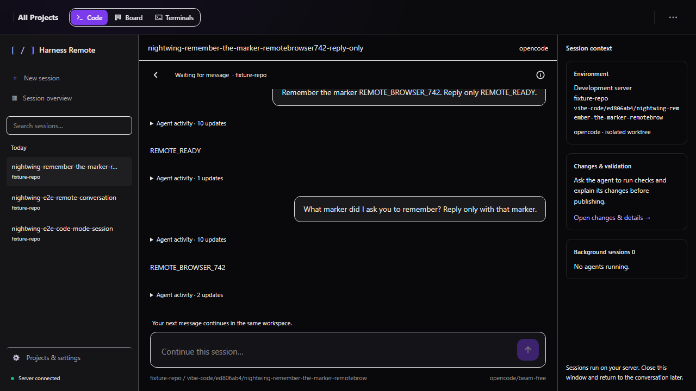

# Harness Remote — code mode and the PWA

> A entrada principal agora é o workspace unificado em `/`, com recursos e
> configurações inline. `/prototype` é um alias e `/legacy` mantém as superfícies
> avançadas descritas abaixo. Consulte [o guia atual](unified-remote-prototype.md)
> para conversa, plugins, effort e terminal na experiência unificada.

Harness Remote is the remote-control surface for the harness: an installable
web app you open on your phone to start a coding session, watch the agent work
and reply to it. It runs entirely against the same server and data as the
kanban board — nothing extra to deploy.

## Two surfaces, one app

The app has three modes, switchable from the header; the choice is remembered in
`localStorage` (`harness-remote-mode`).

| Mode | What it shows | Default |
|---|---|---|
| **Code** | Searchable session history, central conversation, repository/branch/engine/model controls and a context panel. **Session overview** opens the Live now grid. | ✅ |
| **Board** | The kanban board (all existing columns, filters, drag-and-drop, panels, dialogs) | |
| **Terminals** | Interactive agent terminals and locally detected CLI sessions | |

Code mode is a *view* over the same tasks, runs and logs. Every existing
feature (board, task detail, terminal, engines, skills, lanes, schedules,
inbox, runtimes, reviews…) is still present in Board mode — code mode only
adds a mobile-first entry point.

## Session lifecycle

1. **Ask.** Choose a ready repository, base branch, engine (OpenCode by default)
   and model, then send a task. Branches and models are loaded from the server.
   Only engines that can resume a CLI conversation (honor the resume option and
   report a session id) are offered: a follow-up turn reuses the same session, so
   an engine that ignores the resume option (for example, the ACP invocation of
   Claude Code today) is rejected by both the selector and `POST /api/tasks`. A
   remote task also needs an explicit engine; omitting it is rejected rather than
   falling back to an engine that cannot resume. The client creates a task
   tagged `remote-session` and launches its first turn.
2. **Name.** The operator never types a title. If a title is absent, the server
   derives one from the first meaningful line of the prompt:
   `<prefix>-<slug>` (for example `harness-fix-the-login-bug`). The prefix
   defaults to the machine hostname and can be pinned with
   `VIBE_CODE_SESSION_NAME_PREFIX`. When the prompt has no usable text the
   harness falls back to a `adjective-noun` codename. See
   `packages/server/src/utils/session-name.ts`.
3. **Stream.** Opening a session subscribes to its logs over the existing
   WebSocket. Consecutive stdout lines are grouped into a single assistant
   bubble, stderr becomes an error bubble, and `system`/`review` lines render as
   notice chips. Text is ANSI-stripped and rendered as Markdown.
4. **Reply.** Wait for the turn to finish, then send the next message. The server
   resumes the same CLI session in the same worktree through
   `POST /api/tasks/:id/messages`. **Stop** interrupts the current turn. New
   messages are rejected while a turn is running, the runtime is full, or a
   previous workspace/session can no longer be resumed. Failed delivery keeps
   the draft. Reopening a conversation loads persisted logs across its runs,
   including user messages; WebSocket events stream new output.

Conversational sessions retain uncommitted work between turns and across server
restarts. They stay out of the automatic backlog/retry loops. A completed turn
means the agent finished responding; it does **not** certify deterministic
validation. Ask the agent to run checks and review **Changes & validation**.
The harness does not automatically commit, push or create a PR after each turn.
Existing autonomous tasks retain their validation/review/publication pipeline.

History stays visible on desktop and opens as a drawer on phones. The context
panel shows the repository/branch, execution details and background sessions;
it is collapsible on smaller screens. **Projects & settings** opens the existing
management surfaces. **Board**, **Terminals** and **Session overview** remain available.



[New session](screenshots/remote-code/new-session.png) ·
[Mobile repository picker](screenshots/remote-code/mobile.png)

## Running remotely

Install and authenticate OpenCode **on the machine running the server**, then
register repositories in the app. To serve the compiled UI from that server:

```powershell
bun install --frozen-lockfile
bun run build
$env:NODE_ENV = "production"
bun run packages/server/src/index.ts
```

Open the server's reachable address (default port 3000) in your browser. The
existing authentication and repository workspace checks apply to messages as
well. HTTPS is required for PWA installation outside localhost. This change
provides the browser workspace; it does not provision hosting or pair additional
execution hosts. The displayed environment is the current vibe-code server.

OpenCode `run` uses its native executable on Windows, the worktree as process
`cwd`, JSON output, and `--session` on continuation. No `--dir` flag is sent
(OpenCode 2.0.30 rejects it). Both `sessionID` and `sessionId` event fields are
accepted without discarding the accompanying text.

## Skills

Code mode has no skill picker. Skills are resolved automatically from the task
text by the existing matcher (`packages/server/src/skills/matcher.ts`) and
loaded as session plugins — the operator only supplies the task.

## PWA

- `packages/web/public/manifest.webmanifest` — installable metadata, shortcuts,
  maskable icons.
- `packages/web/public/sw.js` — service worker. Navigations are network-first
  with a cached app-shell fallback; hashed `/assets/*` are cache-first;
  `/api`, `/ws` and `/health` are never cached.
- Icons are generated procedurally by `scripts/generate-pwa-icons.ts`
  (`bun run scripts/generate-pwa-icons.ts`) into `packages/web/public` — no
  binary image tooling in the build.
- The server serves `sw.js` and `manifest.webmanifest` with `Cache-Control:
  no-cache` and every other build file by extension, so installs and updates
  land without a hard refresh. See the static handler in
  `packages/server/src/index.ts`.

## Configuration

| Variable | Default | Purpose |
|---|---|---|
| `VIBE_CODE_SESSION_NAME_PREFIX` | hostname | Prefix for auto-generated session names |

## Tests

- `packages/server/src/utils/session-name.test.ts` — slug/prefix/codename rules.
- `packages/server/src/api/tasks.integration.test.ts` — task creation without a
  title derives a session name.
- `packages/web/src/components/code-mode/chat.test.ts` — transcript folding.
- `packages/web/src/components/code-mode/CodeComposer.test.tsx` — composer input.
- `packages/server/src/agents/orchestrator/remote-session.integration.test.ts` —
  two turns preserve the CLI conversation, workspace and uncommitted files.
- `e2e/code-mode.spec.ts` — desktop/mobile workspace and session creation.
  Set `VIBE_E2E_REAL_OPENCODE=1` to opt into two real free-model turns plus
  history recovery after reload; regular tests intercept execution.
  After `bun run build`, set `VIBE_E2E_PRODUCTION_UI=1` to test the compiled UI
  served by the real server instead of the Vite development server.

Server tests use Bun's `--isolate` to prevent process-wide module mocks from
one engine test from contaminating subsequent engine/filesystem tests.
