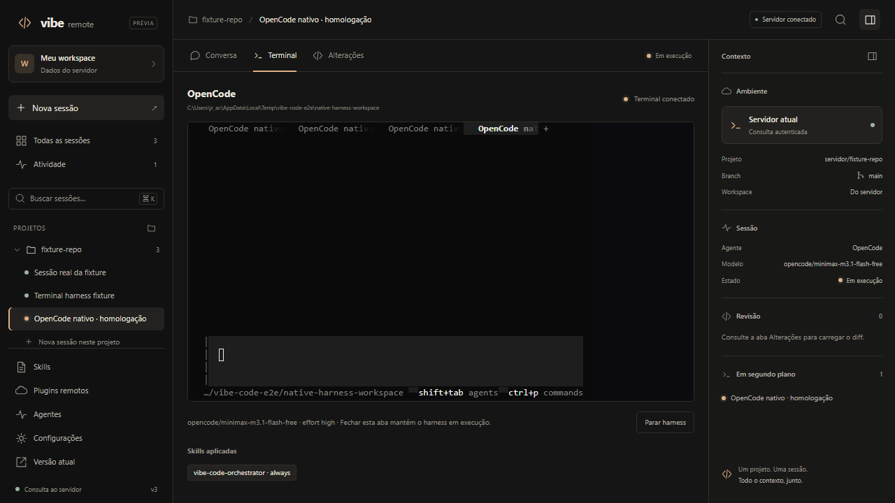

# Workspace remoto unificado — protótipo v3

O candidato fica em **`/prototype`**. Projetos, sessões, conversa, terminal e revisão
compartilham a navegação. Skills, plugins, agentes e configurações são páginas do
workspace, sem kanban nem questionários em modal. A aplicação atual continua em `/`.

## Experimentar no Windows

```powershell
bun install --frozen-lockfile
bun run build
./scripts/preview-unified.ps1
```

Abra [o protótipo local](http://127.0.0.1:5188/prototype). O script sobe o servidor
real, com UI compilada e APIs, restrito a `127.0.0.1`. Banco, clones e registro de
plugins ficam em `%TEMP%/vibe-code-unified-preview`, separados dos dados normais.
É possível escolher `-Port` e `-PreviewDirectory`. Os dados não são apagados ao sair.

Para usar o ambiente existente, sirva o build normalmente e abra `/prototype` na
mesma origem. A autenticação e as permissões das APIs existentes são preservadas.
O Vite preview sozinho permite avaliar a demonstração, mas não fornece as APIs.
A rota abre as sessões reais por padrão. Para avaliar os exemplos fictícios, use
`/prototype?demo=1` ou **Configurações → Interface → Demonstração interativa**.

## Fluxos disponíveis

| Área | Comportamento |
| --- | --- |
| Sessões | Demonstração interativa ou tarefas reais do servidor; criar uma sessão real registra uma tarefa `manual`, sem autoexecução. |
| Projetos | Configurações → Projetos conecta uma URL ou caminho Git e acompanha a preparação do clone. |
| Terminal | Em sessões reais, conecta o xterm ao terminal do harness atual; uma sessão parada oferece iniciar/retomar explicitamente. Abrir uma aba não dispara agentes. |
| Modelo e effort | OpenCode e Claude Code; catálogo consultado no harness instalado, com preferência local para novas sessões e seleção antes de iniciar o terminal. |
| Skills | Busca, categorias, catálogo global e do projeto, leitura das instruções globais e seleção manual ou automática ao iniciar o harness. |
| Plugins remotos | URL GitHub, descoberta da branch padrão, catálogo de skills/agentes/regras/workflows, importação por commit, revisão, ativação e remoção. |
| Agentes | Templates existentes, instruções e skills associadas, com busca e detalhes na própria página. |
| GitHub | Substituir token e testar conexão usando as APIs existentes. O token não é preenchido a partir da resposta mascarada nem persistido no navegador. |
| Configurações | Harness padrão, concorrência, chaves Anthropic/OpenAI/Gemini, gateway LiteLLM e mapa JSON de servidores MCP. |

As páginas de recursos e configurações usam o **servidor real**, mesmo quando a
lista de sessões está em demonstração. O cabeçalho identifica esse contexto.

Ao alternar entre Conversa, Terminal e Alterações, a sessão permanece selecionada.
Fechar a aba ou sair da página apenas desconecta o cliente do terminal; parar o
harness exige a ação correspondente. Runs headless em andamento são identificados
e não recebem um segundo agente pelo botão do protótipo.

## Plugins e harnesses

O catálogo aceita `owner/repo` ou URL GitHub e usa a credencial GitHub do servidor
quando configurada. Cada importação fixa o commit completo. Skills incluem a pasta
inteira, com referências e scripts, respeitando limites de 200 arquivos, 1 MiB por
arquivo e 8 MiB por pacote. Links simbólicos e caminhos inseguros são rejeitados.
O conteúdo fica pendente até a ativação; importar não executa scripts ou hooks.

**Importar todas as skills** processa o catálogo completo, independentemente do
filtro de busca. Cópias da mesma skill são deduplicadas e as já importadas são
preservadas. O progresso informa sucessos, itens existentes e falhas individuais;
uma falha não impede as demais importações. É possível parar após a skill em
andamento ou repetir o botão para tentar os itens restantes. A ativação continua
individual, após revisão.

O fluxo em lote tem quatro testes unitários e dois cenários de navegador cobrindo
deduplicação, preservação de importações, falhas parciais, repetição e interrupção.
[Captura do cenário de falha parcial](screenshots/unified-remote/bulk-import.png).

Os plugins desta tela são recursos de instruções do registro existente. Skills
ativas podem compor o plugin gerado para Claude Code ou as skills do workspace
OpenCode. Não é um instalador de extensões JavaScript ou hooks arbitrários do
OpenCode. Agentes, regras e workflows importados também ficam no catálogo; o
seletor do terminal injeta skills.

No OpenCode 2, o backend cria ou retoma a conversa exata registrada em
`.vibe-code/opencode-session.json` e aplica modelo e variante pela API nativa.
O terminal abre com `--session`, mantendo o contexto. No OpenCode 1, as opções
vêm do catálogo verbose e a variante usa configuração do agente no processo.
Claude Code recebe o effort por `--effort`; os níveis vêm do help instalado, e
a compatibilidade final com o modelo é validada pelo próprio harness.

O backend mantém o transporte de terminal existente: PTY em POSIX e pipes no
Windows. O TUI nativo do OpenCode 2 foi verificado neste Windows; não há nova
implementação ConPTY. O chat consulta os logs persistidos de até cinco runs;
a conversa interativa do harness é acessada pelo terminal.

## Validação

```powershell
bun run typecheck
bun run build
bun run --filter @vibe-code/web test
bunx playwright test --config playwright.prototype.config.ts

# Homologações opcionais, em ambiente isolado; sem enviar prompts ao modelo:
$env:VIBE_PROTOTYPE_LIVE_GITHUB = "1"
$env:VIBE_PROTOTYPE_LIVE_HARNESS = "1"
bunx playwright test --config playwright.prototype.config.ts
```

O Playwright serve a UI compilada pelo servidor real, com banco, repositórios e
registro de skills isolados. A homologação GitHub usa `juninmd/skills`, descobre
`master`, importa `bot-engineering` com os dois arquivos e verifica a ativação na
biblioteca. A homologação nativa abre o TUI instalado em um workspace descartável,
confere modelo, effort, run e continuidade entre abas, sem enviar prompt ao modelo.

Em 20/10/2026: build, typecheck, 190 testes web, 73 testes de servidor do escopo e
12 cenários de navegador passaram; as homologações GitHub
e OpenCode nativo passaram. Os testes de servidor do escopo cobrem pacote completo,
injeção no workspace, revisão, caminhos inválidos, limites, falhas de download,
seleção da conversa e contrato de effort. A suíte geral do servidor mantém as
mesmas 11 falhas preexistentes observadas antes do candidato; o Biome do escopo
passou, mas o lint geral também
tem falhas de formatação em arquivos fora do escopo. Esses gates não estão aprovados.

## Capturas



[Conversa](screenshots/unified-remote/conversation.png) ·
[Plugins do GitHub](screenshots/unified-remote/plugin-catalog.png) ·
[Revisão de plugin](screenshots/unified-remote/plugins-github.png) ·
[Skills](screenshots/unified-remote/skills.png) ·
[Configuração GitHub](screenshots/unified-remote/github.png) ·
[Harness e effort](screenshots/unified-remote/harness-settings.png) ·
[Celular](screenshots/unified-remote/mobile.png)
· [Configurações no celular](screenshots/unified-remote/mobile-settings.png)

O frontend do candidato fica em `packages/web/src/prototypes/unified-remote/`, com
estilos restritos a `rw-*`. Os novos contratos de catálogo e effort são extensões
das APIs de skills, engines e terminal existentes. `VIBE_CODE_SKILLS_PATH` permite
isolar o catálogo/registro, e `VIBE_CODE_HOST` define o endereço de escuta do servidor.
